# Customyzables — Verification & Evidence for Tasks 2–5

**Team Tynamo** · Elaine Ena B. Villaluna · Johnriel Dave L. Legara  
University of Cebu — College of Computer Studies · Capstone Project

| | |
| --- | --- |
| **Project** | Customyzables — a textile donation and upcycling hub for Lapu-Lapu City |
| **Repository** | `github.com/jazxander00/Customyzables` (branch `main`, commit `70cce02`) |
| **Verified on** | 13 November 2026 |
| **Application URL** | `http://localhost:8000` (local demo instance) |
| **Document purpose** | Prove that every deliverable in Tasks 2, 3, 4, and 5 of *Project Deliverables & Milestones* exists, works, and is backed by code, database structure, screenshots, and test output |

> **How to read this document.** Each deliverable from the official milestones document is listed with (a) its status, (b) the files and routes that implement it, (c) a screenshot or command output captured from the running system, and (d) the automated test that guards it. Raw evidence files sit next to this document in `docs/evidence/`, and every screenshot in `docs/evidence/screenshots/` was captured from the live application during verification — not mocked or drawn.

---

## Contents

<div class="toc">
<ol>
<li>Summary of results</li>
<li>Verification environment</li>
<li>Evidence map</li>
<li>Task 2 — User Authentication &amp; Data Management</li>
<li>Task 3 — Database Integration &amp; Complex Transactions</li>
<li>Task 4 — Reporting and Data Visualization</li>
<li>Task 5 — System Refinement, Testing &amp; Deployment</li>
<li>Reproducing this evidence</li>
<li>Suggested demo script for the panel</li>
<li>Known gaps and limitations</li>
<li>Evidence inventory</li>
<li class="appendix">Appendix A — Route map (46 routes)</li>
<li class="appendix">Appendix B — Database at verification time</li>
<li class="appendix">Appendix C — Test output</li>
</ol>
</div>

---

## 1. Summary of results

| Task | Official deliverable | Status | Primary evidence |
| --- | --- | --- | --- |
| **2** | User authentication & data management | **Implemented and verified** | Registration, login, logout, bcrypt storage, server-side validation, session guard, role isolation, full donation CRUD |
| **3** | Database integration & complex transactions | **Implemented and verified** | 11-table relational schema, foreign keys with CASCADE/SET NULL, `DB::transaction` workflows, 3-way INNER JOIN and LEFT JOIN reports |
| **4** | Reporting and data visualization | **Implemented and verified** | Date-ranged summary report, monthly and per-fibre charts, transaction history, user activity, CSV export |
| **5** | System refinement, testing & deployment | **Implemented; cloud deployment optional and not executed** | 21 automated tests (81 assertions), defect log with fixes, 17-commit Git history, README + DEPLOYMENT guide, Docker/Render/Railway assets |

**Automated test result (13 Nov 2026):**

```text
Tests:    21 passed (81 assertions)
Duration: 1.58s
```

---

## 2. Verification environment

| Item | Value |
| --- | --- |
| Framework | Laravel 10.50 (`composer.json`: `laravel/framework ^10.0`, `php ^8.1`) |
| PHP used for verification | 8.3.36 (portable build) |
| Database for walkthrough | SQLite 3 — `database/database.sqlite` |
| Database for tests | SQLite in-memory (`DB_CONNECTION=sqlite`, `DB_DATABASE=:memory:`) |
| Front-end | Vite 4 + Tailwind CSS 3.4, anime.js 4.5 |
| Browser used for screenshots | Google Chrome (headless), viewport 1440 × 1000 |
| Routes registered | 46 (`php artisan route:list --json`) |
| Seed data | 7 users, 10 donations, 10 images, 5 requests, 2 messages |
| Local server | `php artisan serve --host=127.0.0.1 --port=8000` |

### Demo accounts

All demo passwords are `password`.

| Role | Email | Used for |
| --- | --- | --- |
| Admin | `admin@customyzables.test` | Reports, CSV, moderation, audit trail |
| Donor | `elaine@customyzables.test` | Donation CRUD, donor dashboard |
| Donor | `maria@customyzables.test` | Existing chat conversation |
| Upcycler (verified) | `johnriel@customyzables.test` | Request workflow |
| Upcycler (unverified) | `marisol@customyzables.test` | Verification gate |

---

## 3. Evidence map

| # | Screenshot | What it proves | Used in |
| --- | --- | --- | --- |
| 01 | `01-landing.png` | Public landing page renders; unauthenticated access works | Task 2 |
| 02 | `02-register-validation.png` | Registration form and server-side validation errors | Task 2 |
| 03 | `03-login-error.png` | Login rejects invalid credentials with a safe message | Task 2 |
| 04 | `04-chat.png` | Authenticated messaging between donor and upcycler | Task 2 / 3 |
| 05 | `05-donation-form.png` | 3-step donation form with an attached photo | Task 2 |
| 06 | `06-donation-detail.png` | Created donation persisted with image, status and activity log | Task 2 / 3 |
| 07 | `07-donor-dashboard.png` | Donor dashboard aggregating live database records | Task 2 / 4 |
| 08 | `08-role-isolation.png` | A donor is blocked from `/admin` with HTTP 403 | Task 2 |
| 09 | `09-browse-feed.png` | Public feed reading joined donation + image + donor data | Task 3 |
| 10 | `10-admin-dashboard.png` | Admin overview computed from the database | Task 4 |
| 11 | `11-admin-report-summary.png` | Date-ranged summary report with charts | Task 4 |
| 12 | `12-admin-report-transactions.png` | Transaction history from a three-way join | Task 3 / 4 |
| 12b | `12b-admin-user-activity.png` | User activity grouped by actor (LEFT JOIN) | Task 4 |
| 13 | `13-csv-export.png` | CSV export contents and HTTP headers | Task 4 |

Text evidence files:

| File | Contents |
| --- | --- |
| `docs/evidence/routes.txt` | All 46 routes with controller action and role guard |
| `docs/evidence/routes.json` | Machine-readable route list |
| `docs/evidence/database-schema.txt` | Every table, column, index-level constraint, foreign key and row count |
| `docs/evidence/auth-and-data-state.txt` | bcrypt hash proof, user roles, record counts, status distribution |
| `docs/evidence/tests.txt` | Full `php artisan test` output |
| `docs/evidence/transactions.csv` | The actual CSV downloaded from the report |
| `docs/evidence/git-log.txt` | Commit history used for Task 5 |
| `docs/evidence/git-status.txt` | Working-tree state at verification time |

---

## 4. Task 2 — User Authentication & Data Management

> **Official deliverables:** registration, login, logout; password encryption (BCrypt); secure session-based authentication; frontend and backend validation; session handling and access control; CRUD operations with at least one fully functional, database-integrated module.

### 4.1 Registration (sign-up)

| Item | Evidence |
| --- | --- |
| Routes | `GET /register` → `register`, `POST /register` → `register.store` (`routes/web.php:23–24`) |
| Controller | `app/Http/Controllers/Auth/RegisterController.php` |
| Validation | `app/Http/Requests/RegisterRequest.php` |
| Screenshot | `docs/evidence/screenshots/02-register-validation.png` |

The form collects name, email, password + confirmation, account type (donor or upcycler), and optional barangay, phone, and organisation. Server-side rules in `RegisterRequest`:

| Field | Rule |
| --- | --- |
| `name` | required, string, max 120 |
| `email` | required, lowercase, valid email, max 190, **unique in `users`** |
| `password` | required, confirmed, `Password::min(8)` |
| `role` | required, one of the `Role` enum values |
| `barangay`, `phone`, `organization` | optional, bounded strings |

On success the controller creates the user, logs them in, regenerates the session ID, and writes a `user.registered` audit entry:

```php
$user = User::create([...]);
Auth::login($user);
$request->session()->regenerate();
AuditLog::record('user.registered', $user, ['role' => $user->role->value], $user);
```

Registration also demonstrates the required **frontend + backend validation pair**: the Blade form uses HTML `required`, `type="email"`, and `minlength`, while `RegisterRequest` re-validates everything on the server. Screenshot 02 was taken by submitting the empty form with browser validation disabled, so the visible errors are Laravel's server-side messages — proving the backend layer works independently of the browser.

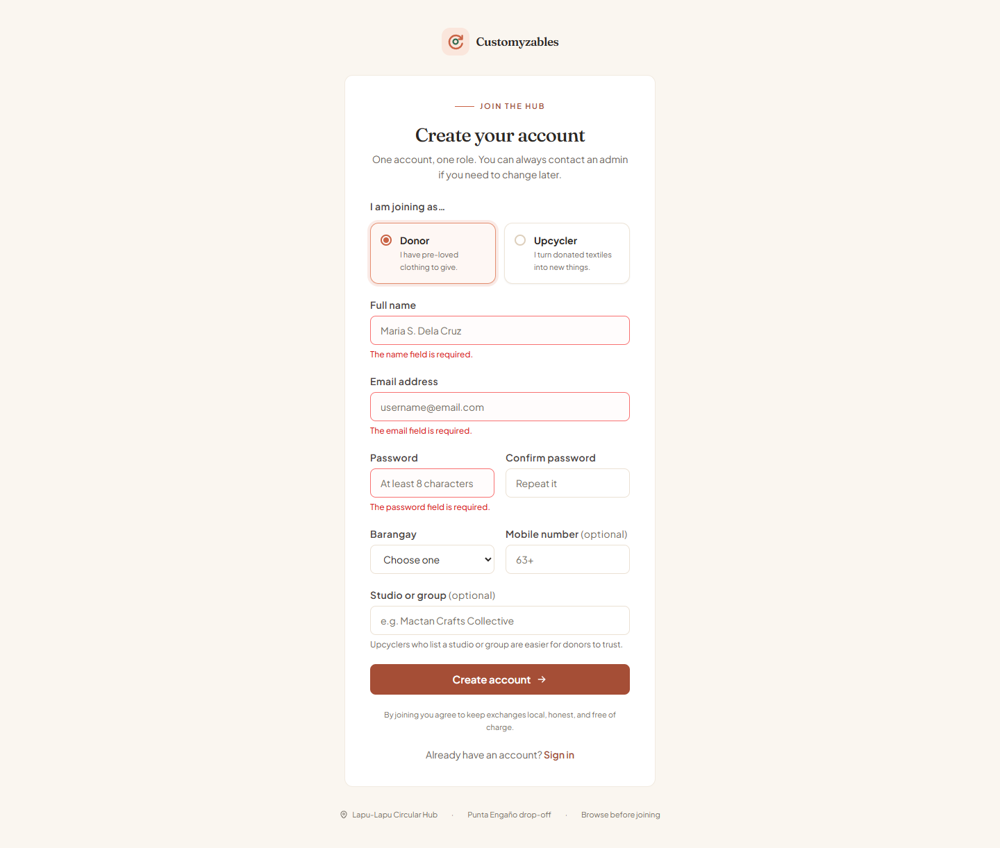

*Figure 1 — Registration form after an empty submit with browser validation disabled. Laravel returns field-level errors for name, email, password, and role.*

### 4.2 Login (sign-in)

| Item | Evidence |
| --- | --- |
| Routes | `GET /login` → `login`, `POST /login` → `login.store` (`routes/web.php:25–26`) |
| Controller | `app/Http/Controllers/Auth/SessionController.php:23–62` |
| Screenshot | `docs/evidence/screenshots/03-login-error.png` |

The login flow implements more than a credential check:

1. **Validation** — email format and required password.
2. **Rate limiting** — five attempts per email + IP per minute (`RateLimiter::tooManyAttempts($key, 5)`).
3. **Authentication** — `Auth::attempt()` against the stored bcrypt hash.
4. **Suspension check** — a suspended account is logged out immediately even with correct credentials.
5. **Session regeneration** — `$request->session()->regenerate()` prevents session fixation.
6. **Role-aware redirect** — the user lands on the dashboard for their role via `$user->role->dashboardRoute()`.

Screenshot 03 shows the deliberately wrong password being rejected with a generic message (“Those details do not match an account.”), which avoids revealing whether the email exists.

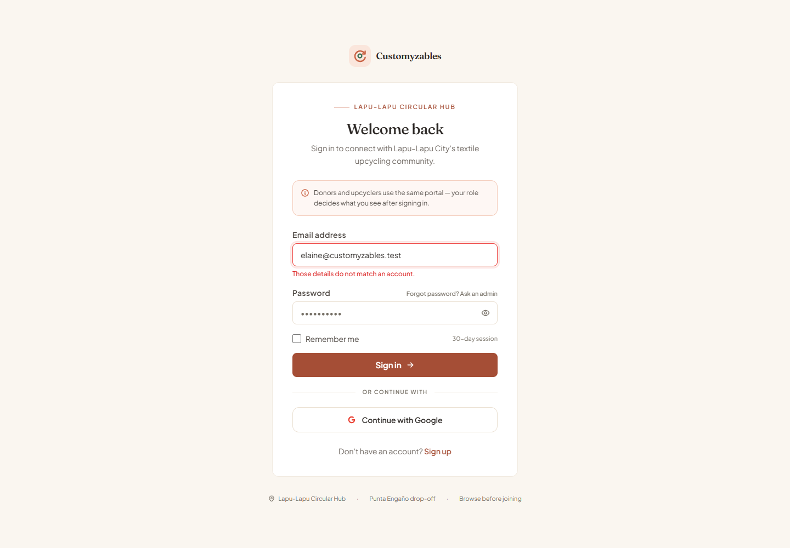

*Figure 2 — Failed login attempt. The form returns a generic credential error instead of disclosing whether the email is registered.*

### 4.3 Logout

| Item | Evidence |
| --- | --- |
| Route | `POST /logout` → `logout` (`routes/web.php:33`) |
| Controller | `app/Http/Controllers/Auth/SessionController.php:86–94` |
| Test | `test_roles_cannot_reach_each_others_areas` (authenticated guards) |

```php
Auth::logout();
$request->session()->invalidate();
$request->session()->regenerateToken();
```

Logout is a `POST` route protected by CSRF, invalidates the session, and rotates the CSRF token.

### 4.4 Password encryption (BCrypt)

| Item | Evidence |
| --- | --- |
| Storage | `users.password`, cast as `hashed` in `app/Models/User.php` |
| Proof | `docs/evidence/auth-and-data-state.txt` |

Captured from the running database:

```text
Account:            elaine@customyzables.test
Stored hash prefix: $2y$10$...
Hash algorithm:     bcrypt
Plaintext stored?   NO - users.password holds a one-way bcrypt hash only
Hash::check('password'): true
Hash::check('wrong'):    false
```

No plaintext password is stored or logged. The `$2y$10$` prefix identifies bcrypt with cost 10.

### 4.5 Session handling and access control

| Item | Evidence |
| --- | --- |
| Middleware | `app/Http/Middleware/EnsureRole.php` |
| Route groups | `routes/web.php:32–91` |
| Screenshot | `docs/evidence/screenshots/08-role-isolation.png` |
| Tests | `test_roles_cannot_reach_each_others_areas`, `test_donors_cannot_view_admin_reports` |

Three route groups enforce access:

- `guest` — registration and login only.
- `auth` — shared pages (chat, profile, dashboards).
- `role:donor`, `role:upcycler`, `role:admin` — role-specific areas.

`EnsureRole` rejects unauthenticated users, suspended accounts, and wrong-role accounts with HTTP 403 before the controller runs:

```php
abort_unless($user, 403, 'You need to sign in first.');
abort_if($user->is_suspended, 403, 'This account is suspended. Contact the organizers.');
abort_unless(in_array($user->role->value, $roles, true), 403, 'This area is not available for your account type.');
```

Screenshot 08 shows a signed-in **donor** requesting `/admin` and receiving the branded 403 page (“That area isn't yours… signed in as Donor”). The automated tests assert the same for donor → admin, donor → upcycler dashboard, and upcycler → donor listings.

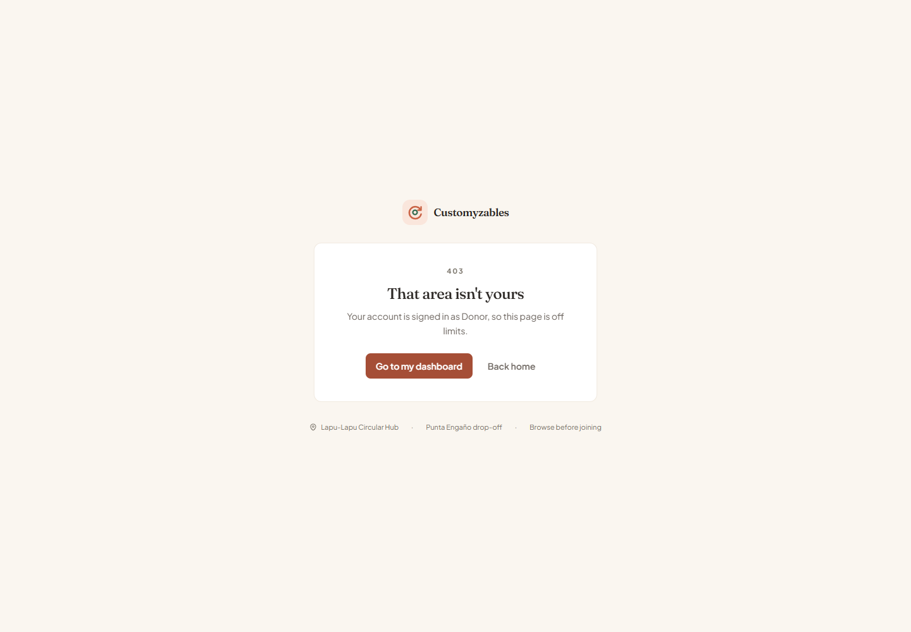

*Figure 3 — A donor session requesting `/admin` is stopped by the role middleware with a branded 403 page.*

Authorization is also re-checked inside actions, not just at the route level. For example, `DonationWorkflow::request()` calls `abort_unless($upcycler->canRequestDonations(), 403)` so an unverified upcycler cannot bypass the UI by posting directly. That behaviour is covered by `test_unverified_upcycler_cannot_request`.

### 4.6 CRUD operations — the donation module

The donation module is the fully functional, database-integrated module required by Task 2. Every operation touches real rows and enforces ownership.

| CRUD | Route | Controller method | Screenshot / test |
| --- | --- | --- | --- |
| **Create** | `POST /donations` | `DonationController@store` | 05 (form), 06 (result); `test_donor_can_publish_a_donation` |
| **Read** | `GET /donations`, `GET /donations/{id}` | `DonationController@index`, `show` | 07 (list/dashboard), 06 (detail) |
| **Update** | `GET /donations/{id}/edit`, `PUT /donations/{id}` | `DonationController@edit`, `update` | `test_donor_can_update_a_listed_donation` |
| **Delete** | `POST /donations/{id}/cancel`, `DELETE /donations/{id}` | `DonationController@cancel`, `destroy` | Ownership + status guards in code |

**Create.** The Blade form posts `multipart/form-data` with up to four photos. `StoreDonationRequest` validates length, category, condition, weight (0.1–500 kg), item count, barangay, handoff method, and images (`image`, `mimes:jpg,jpeg,png,webp`, max 4096 KB each). The controller writes the donation, stores each photo on the `public` disk under `donations/{id}`, inserts `donation_images` rows, and writes the first `donation_events` row. Screenshot 05 shows the completed form with `demo-fabric.png` attached; screenshot 06 shows the persisted record, image, status stepper (“Listed”), and activity log.

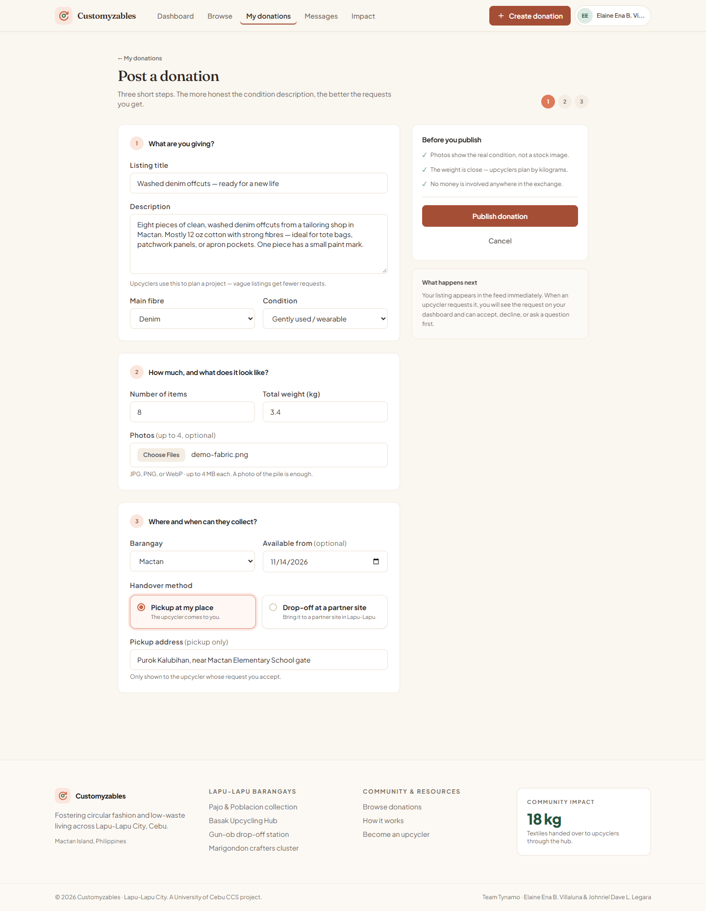

*Figure 4 — The three-step donation form, completed, with a photo attached before publishing.*

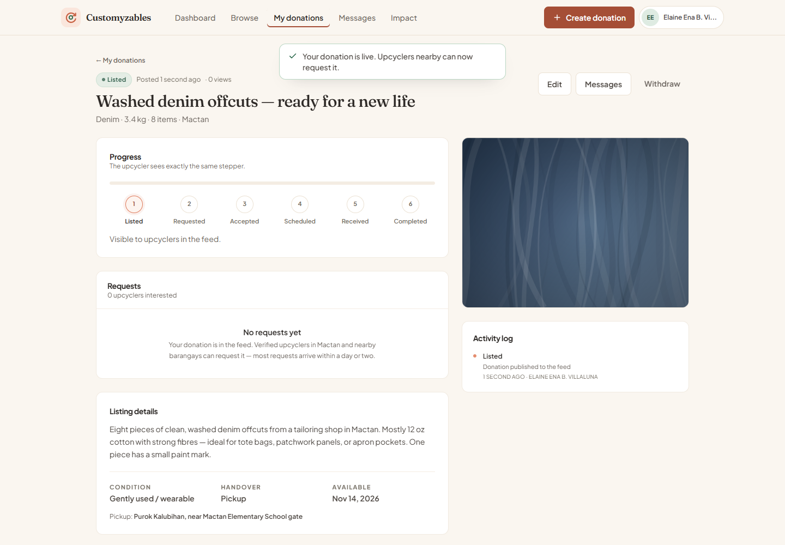

*Figure 5 — The created donation. The photo, status stepper, listing details, and first activity-log entry all come from the database.*

**Read.** Donors see only their own donations (`$request->user()->donations()`), with images, pending-request counts, and the accepted upcycler eager-loaded. The public feed (`/browse`) is a separate read path that joins donation + image + donor data (Task 3). Screenshot 07 shows the donor dashboard with live counts (open listings, waiting on you, completed, textiles given) computed from the same tables.

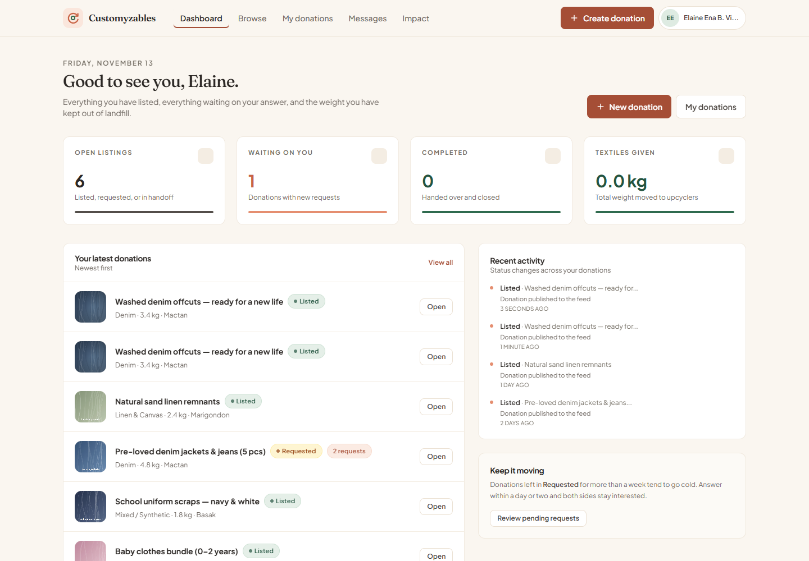

*Figure 6 — Donor dashboard. The counters and the “latest donations” list are aggregate queries over donations, requests, and donation_events.*

**Update.** Only the owner may edit, and only while the donation is still `listed`:

```php
abort_unless($donation->user_id === $request->user()->id, 403);
abort_unless($donation->status === DonationStatus::Listed, 403, 'Only a listed donation can be edited.');
```

This is guarded by three tests: owner can update, a different donor cannot, and a donation that already has requests cannot.

**Delete.** Deleting is a two-step flow: the donor first withdraws (`cancel`), which transitions the donation to `cancelled` and withdraws open requests; only then can the record be deleted. The controller removes the stored image files before deleting the row, so the public disk does not accumulate orphans.

### 4.7 Task 2 verification checklist

| Requirement | Result |
| --- | --- |
| Registration | ✅ `/register`, validated, tested |
| Login | ✅ `/login`, rate-limited, tested |
| Logout | ✅ `POST /logout`, session invalidated |
| BCrypt password encryption | ✅ `$2y$10$` hash, `Hash::check` verified |
| Secure session authentication | ✅ session regeneration, CSRF, auth middleware |
| Frontend + backend validation | ✅ HTML constraints + FormRequests; screenshot 02 |
| Access control | ✅ `role:` middleware, 403 screenshot 08 |
| CRUD module with DB integration | ✅ donations create/read/update/delete, screenshots 05–07 |

---

## 5. Task 3 — Database Integration & Complex Transactions

> **Official deliverables:** transactions involving two or more related tables; proper foreign keys and relationships; joins (INNER, LEFT, etc.); data consistency and integrity handling.

### 5.1 Relational schema

The application uses **11 tables**. The core domain tables and their relationships:

| Table | Purpose | Key relationships |
| --- | --- | --- |
| `users` | Donors, upcyclers, admins | Parent of donations, requests, messages, events, audit logs |
| `donations` | Textile bundles | `user_id → users.id` (CASCADE) |
| `donation_images` | Photos per donation | `donation_id → donations.id` (CASCADE) |
| `donation_requests` | Upcycler requests for a bundle | `donation_id → donations.id` (CASCADE), `upcycler_id → users.id` (CASCADE), unique `(donation_id, upcycler_id)` |
| `messages` | One conversation per donation | `donation_id → donations.id` (CASCADE), `sender_id → users.id` |
| `donation_events` | Status-change trail | `donation_id → donations.id` (CASCADE), `actor_id → users.id` (SET NULL) |
| `audit_logs` | Privileged actions | `actor_id → users.id` (SET NULL) |

Full column-level proof — including every foreign key and its `ON DELETE` rule — is in `docs/evidence/database-schema.txt`. Representative output:

```text
TABLE: donation_requests  (rows: 5)
  id              INTEGER   PK NOT NULL
  donation_id     INTEGER   NOT NULL
  upcycler_id     INTEGER   NOT NULL
  status          varchar   NOT NULL default 'pending'
  Foreign keys:
    upcycler_id -> users.id      (on delete CASCADE)
    donation_id -> donations.id  (on delete CASCADE)

TABLE: donation_events  (rows: 10)
  Foreign keys:
    actor_id    -> users.id       (on delete SET NULL)
    donation_id -> donations.id   (on delete CASCADE)
```

The migration for `donation_requests` also enforces the business rule that one upcycler cannot request the same bundle twice:

```php
$table->unique(['donation_id', 'upcycler_id']);
```

### 5.2 Multi-table transactions

Every donation status change is wrapped in `DB::transaction` inside `app/Services/DonationWorkflow.php`. A single user action writes to **three or more related tables** atomically: `donation_requests`, `donations`, `donation_events`, and `audit_logs`.

**Creating a request** (`DonationWorkflow::request`, lines 52–62):

```php
return DB::transaction(function () use ($donation, $upcycler, $message) {
    $request = $donation->requests()->create([
        'upcycler_id' => $upcycler->id,
        'message' => $message,
        'status' => RequestStatus::Pending,
    ]);

    $this->transition($donation, DonationStatus::Requested, $upcycler, 'Request received from ' . $upcycler->name);

    return $request;
});
```

**Accepting a request** (`accept`, lines 69–88) is the strongest example: it updates the accepted request, **auto-declines every competing pending request** in the same transaction, and appends the donation transition and audit entry:

```php
return DB::transaction(function () use ($request, $actor) {
    $request->forceFill([
        'status' => RequestStatus::Accepted,
        'responded_at' => Carbon::now(),
    ])->save();

    $request->donation->requests()
        ->whereKeyNot($request->getKey())
        ->where('status', RequestStatus::Pending->value)
        ->update([
            'status' => RequestStatus::Declined->value,
            'responded_at' => Carbon::now(),
        ]);

    $this->transition($request->donation, DonationStatus::Accepted, $actor, 'Request accepted by donor');

    return $request->refresh();
});
```

If any statement throws, the whole unit rolls back — no half-accepted request, no orphaned event, no donation stuck in an impossible state. `test_full_request_flow_from_listed_to_completed` walks `listed → requested → accepted → scheduled → received → completed` and asserts that exactly five history events exist at the end.

### 5.3 Joins (INNER and LEFT)

**Three-way INNER JOIN — transaction history** (`ReportController::transactions`, lines 141–159). It joins requests to donations, then to users twice under separate aliases (donor and upcycler):

```php
return DonationRequest::query()
    ->join('donations', 'donations.id', '=', 'donation_requests.donation_id')
    ->join('users as donors', 'donors.id', '=', 'donations.user_id')
    ->join('users as upcyclers', 'upcyclers.id', '=', 'donation_requests.upcycler_id')
    ->whereBetween('donation_requests.created_at', [$from, $to])
    ->orderByDesc('donation_requests.created_at')
    ->select([
        'donation_requests.created_at',
        'donation_requests.status',
        'donations.title as donation_title',
        'donations.weight_kg',
        'donors.name as donor_name',
        'upcyclers.name as upcycler_name',
    ]);
```

Screenshot 12 shows the result: each row contains the request date, donation title, donor name, upcycler name, status, and weight — data from three tables in one row.

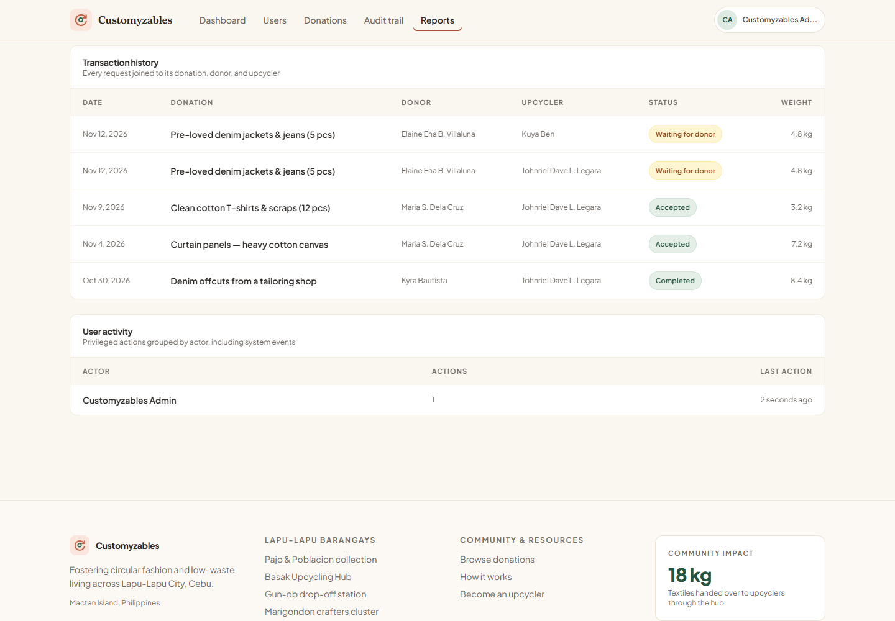

*Figure 7 — Transaction history. Each row is produced by joining `donation_requests`, `donations`, and `users` twice (donor and upcycler aliases).*

**LEFT JOIN — user activity** (`ReportController::activity`, lines 129–139). A LEFT JOIN keeps system-generated actions, where `actor_id` is null, in the report:

```php
return AuditLog::query()
    ->leftJoin('users', 'users.id', '=', 'audit_logs.actor_id')
    ->selectRaw("COALESCE(users.name, 'System') as actor, COUNT(*) as total, MAX(audit_logs.created_at) as last_at")
    ->groupBy('audit_logs.actor_id', 'users.name')
    ->orderByDesc('total')
    ->get();
```

**Eager-loaded relationships** are used on the read side (public feed, donation detail, dashboards) to avoid N+1 queries, for example `->with(['images', 'donor', 'requests.upcycler'])`.

### 5.4 Data consistency and integrity

| Control | Implementation |
| --- | --- |
| Foreign keys + cascade | Every child table constrained in its migration; deleting a donation removes its images, requests, and events |
| `SET NULL` history | Deleting a user keeps `donation_events` / `audit_logs` rows, with `actor_id` nulled |
| Unique request | DB unique index on `(donation_id, upcycler_id)` |
| Enum-typed states | `DonationStatus`, `RequestStatus`, `Role`, `HandoffMethod` PHP enums cast on models |
| Legal transitions only | `DonationWorkflow` rejects invalid moves, e.g. scheduling only an accepted request |
| Ownership checks | `abort_unless($donation->user_id === $request->user()->id, 403)` on update/show/cancel/delete |
| Atomic writes | `DB::transaction` around every multi-table status change |
| Audit trail | Every transition writes `donation_events` + `audit_logs` |

Screenshot 09 (`09-browse-feed.png`) is the visible proof that relational reads compose correctly: each card combines a donation row, its image row, and donor/barangay data, with filters applied to the same query.

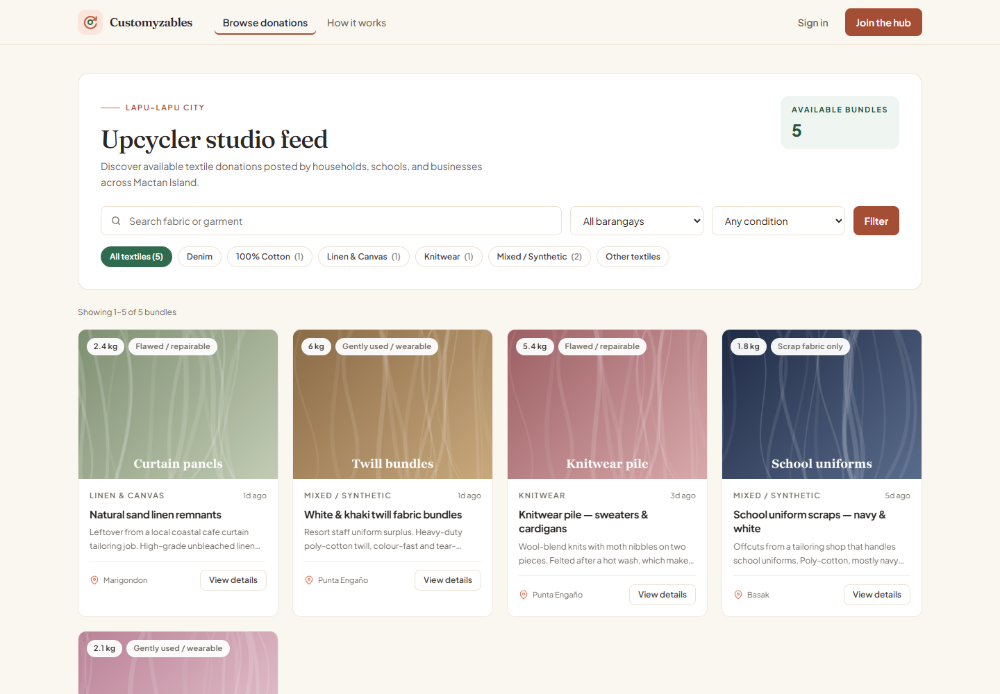

*Figure 8 — Public browse feed. Cards are eager-loaded from donations, `donation_images`, and donor data; filters run against the same relational query.*

The chat feature is also relational: every conversation is anchored to a donation, and access is granted only to the donor and the upcyclers who requested it (`ChatController::isParticipant`).

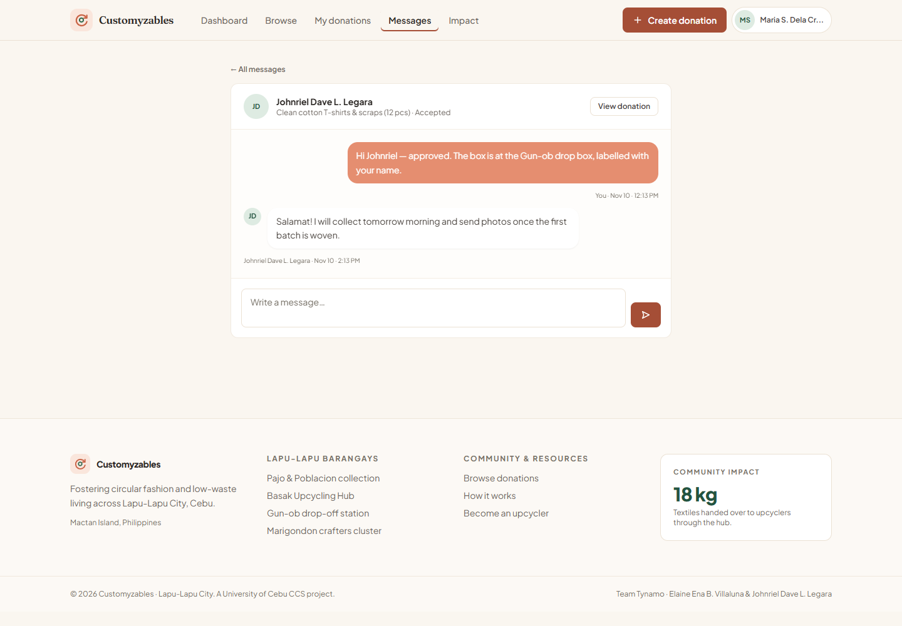

*Figure 9 — One conversation per donation. Messages join to their sender; the header links back to the donation and shows its current status.*

### 5.5 Task 3 verification checklist

| Requirement | Result |
| --- | --- |
| Transactions across 2+ related tables | ✅ requests + donations + events + audit logs in `DB::transaction` |
| Foreign keys and relationships | ✅ 8 FK constraints, documented in `database-schema.txt` |
| Joins (INNER, LEFT, etc.) | ✅ three-way INNER JOIN; LEFT JOIN with `COALESCE` |
| Data consistency / integrity | ✅ unique constraint, cascade rules, enum states, guarded transitions |

---

## 6. Task 4 — Reporting and Data Visualization

> **Official deliverables:** system-generated summary reports, transaction history, user activity logs; optional charts/graphs and export features (PDF, Excel, CSV).

All reports are generated live from the database at `/admin/reports`, protected by `role:admin` and date-range filterable (`from`, `to`, default last 30 days). Nothing is hard-coded.

### 6.1 Summary report

Screenshot `11-admin-report-summary.png` shows the report for 14 Oct – 13 Nov 2026:

| Card | Value | Source |
| --- | --- | --- |
| Donations posted | 10 | `COUNT(*)` on `donations` in range |
| Requests received | 5 | `COUNT(*)` on `donation_requests`, with 20% completed |
| Handovers done | 2 | donations with status `received` or `completed` |
| Textiles posted | 51 kg | `SUM(weight_kg)` |

The admin dashboard (`10-admin-dashboard.png`) adds platform-level counters: 3 donors, 3 upcyclers (1 awaiting verification), 5 live donations, 18 kg moved, 4 open requests.

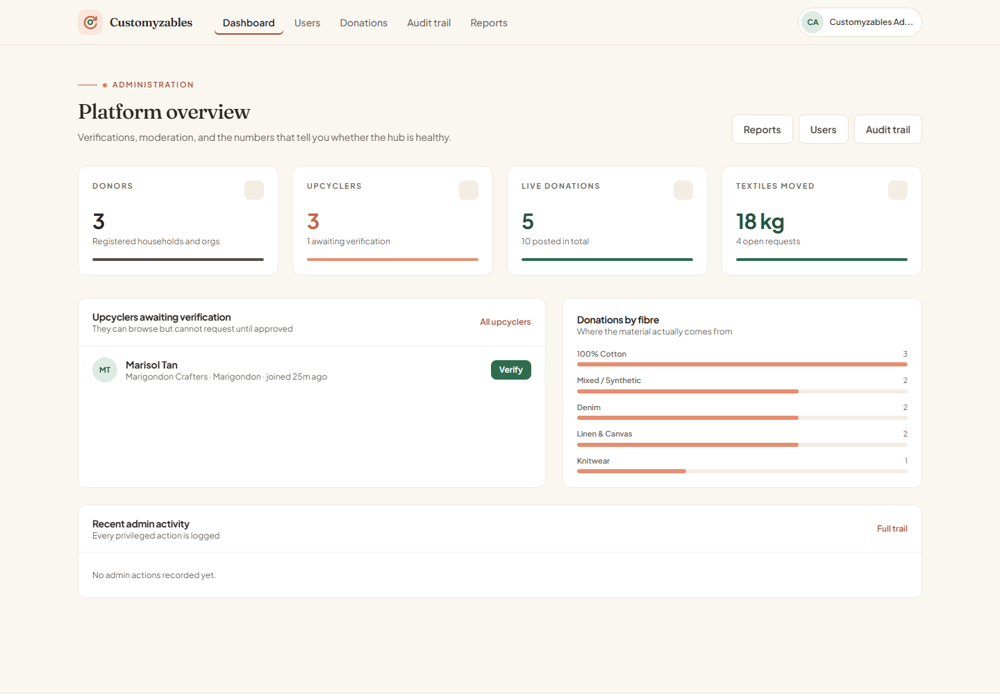

*Figure 10 — Admin platform overview. Every counter and bar is a live aggregate; nothing is static markup.*

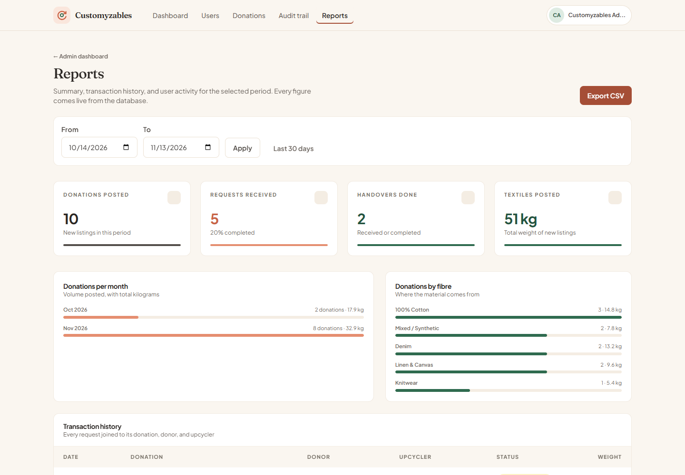

*Figure 11 — The date-ranged report: four summary cards, donations per month, donations by fibre, transaction history, and user activity on one page.*

### 6.2 Charts and data visualization

The optional chart deliverable is implemented without an external chart library, using server-computed aggregates rendered as accessible progress bars:

- **Donations per month** — `SELECT month, COUNT(*), SUM(weight_kg) … GROUP BY month`:
  - Oct 2026 — 2 donations, 17.9 kg
  - Nov 2026 — 8 donations, 32.9 kg
- **Donations by fibre** — `GROUP BY category`:
  - 100% Cotton 3 / 14.8 kg · Denim 2 / 13.2 kg · Linen & Canvas 2 / 9.6 kg · Mixed/Synthetic 2 / 7.8 kg · Knitwear 1 / 5.4 kg

The month grouping is intentionally driver-aware so the same report works on MySQL and SQLite:

```php
private function monthExpression(): string
{
    return DB::connection()->getDriverName() === 'sqlite'
        ? "strftime('%Y-%m', created_at)"
        : "DATE_FORMAT(created_at, '%Y-%m')";
}
```

### 6.3 Transaction history

Screenshot `12-admin-report-transactions.png` shows five request rows joined across `donation_requests`, `donations`, and `users` (donor and upcycler aliases), paginated at 25 rows. Columns: date, donation, donor, upcycler, status badge, weight. The same builder feeds the CSV export, so the screen and the file can never disagree.

### 6.4 User activity logs

Two layers exist:

1. **Audit trail** — every privileged action is written to `audit_logs` with actor, action, subject, metadata, IP, and timestamp. The admin UI at `/admin/audit` lists them (20 per page).
2. **Report grouping** — the report groups audit entries by actor with a LEFT JOIN so system actions appear as “System”.

Screenshot `12b-admin-user-activity.png` shows the **User activity** section after an admin verification action: actor “Customyzables Admin”, 1 action, “2 seconds ago”. That action was performed through the real UI to generate the evidence and then reverted; the audit rows created for the screenshot were removed afterwards, restoring the demo database to its seeded state.

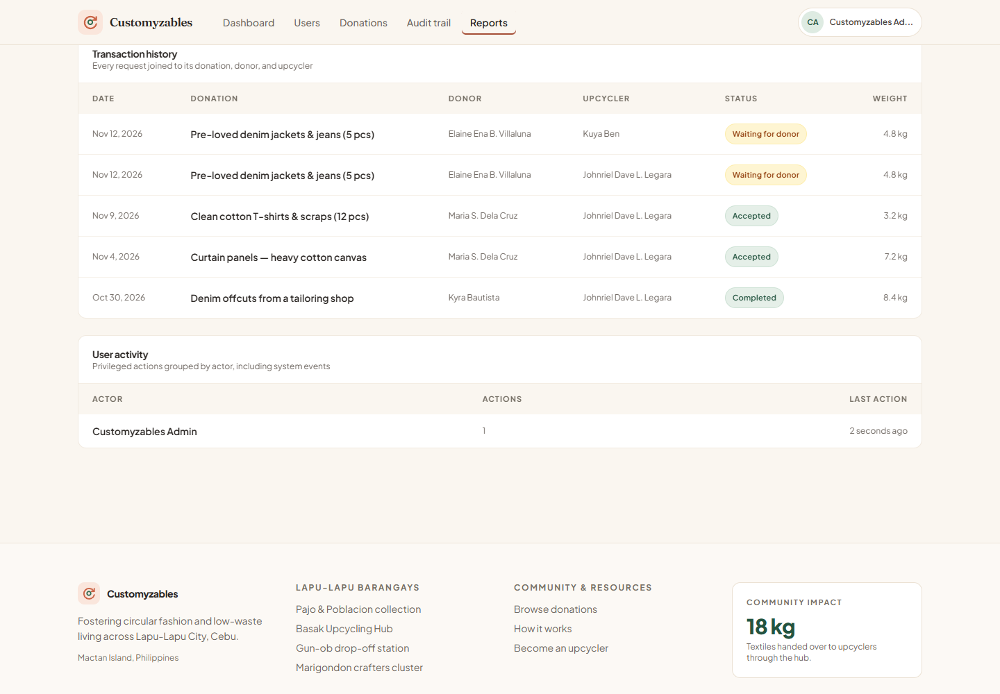

*Figure 12 — User activity grouped by actor. The LEFT JOIN keeps system actions (null actor) as “System” instead of dropping them.*

### 6.5 CSV export

| Item | Evidence |
| --- | --- |
| Route | `GET /admin/reports/export` → `admin.reports.export` |
| Controller | `ReportController::export` (lines 33–60) |
| Screenshot | `docs/evidence/screenshots/13-csv-export.png` |
| Actual file | `docs/evidence/transactions.csv` |
| Tests | `test_admin_can_view_reports_and_export_csv`, `test_csv_export_neutralises_spreadsheet_formulas`, `test_donors_cannot_view_admin_reports` |

Captured HTTP response:

```text
HTTP 200
Content-Type: text/csv; charset=UTF-8
Content-Disposition: attachment; filename=customyzables-transactions-20261014-20261113.csv
```

Exported columns: `Date, Donation, Donor, Upcycler, Status, Scheduled, Completed, Weight (kg)` — 5 data rows matching the on-screen table. A UTF-8 BOM is written so Excel opens accented names correctly, and free-text cells are prefixed with `'` when they begin with `=`, `+`, `-`, `@`, tab, or carriage return, neutralising spreadsheet formula injection:

```php
return preg_match('/^[=+\-@\t\r]/', $value) ? "'".$value : $value;
```

Screenshot 13 renders the downloaded file exactly as opened, including the filename, content type, and row count in the header.

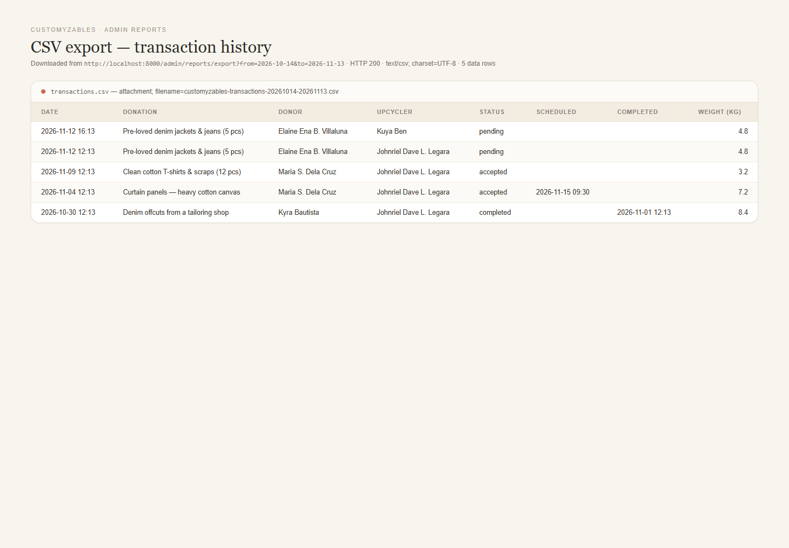

*Figure 13 — The exported CSV rendered as a table. Header shows the authenticated download URL, HTTP 200, `text/csv`, and five data rows.*

### 6.6 Task 4 verification checklist

| Requirement | Result |
| --- | --- |
| Summary report | ✅ four live cards, date-ranged |
| Transaction history | ✅ three-way join, paginated |
| User activity logs | ✅ `audit_logs`, grouped by actor |
| Charts/graphs (optional) | ✅ monthly and per-fibre bar visualisations |
| Export (optional) | ✅ CSV with correct headers, BOM, and formula neutralisation |

---

## 7. Task 5 — System Refinement, Testing & Deployment

> **Official deliverables:** UI/UX improvements; code optimisation and cleanup; functional testing and bug fixing; updated GitHub repository with proper commits and README; optional cloud deployment.

### 7.1 UI/UX refinement

The interface is a custom design system rather than an off-the-shelf admin template:

- Warm paper surfaces (`sand`), terracotta primary actions (`clay`), forest green for progress (`forest`).
- Shared component classes in `resources/css/app.css`: `.card`, `.btn-primary`, `.field`, `.badge-*`, `.stat-card`, `.chip`.
- Purpose-built pages: 3-step donation form, lifecycle stepper, role dashboards, chat, reports.
- Motion via anime.js with `prefers-reduced-motion` support and progressive enhancement (content stays visible if JS fails).
- Responsive navigation with a mobile menu; accessible labels, focus styles, and skip link.

Evidence: screenshots 01–13 show consistent typography, spacing, status badges, empty states, and branded 403/404 pages (screenshot 08 shows the branded 403).

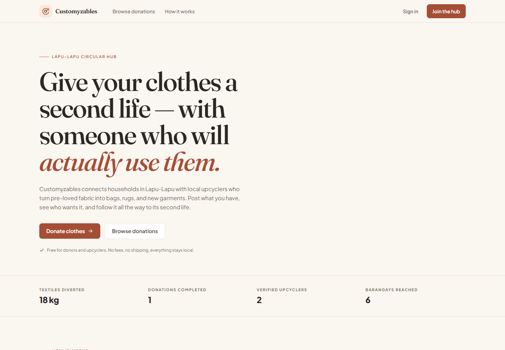

*Figure 14 — Public landing page. Editorial typography, terracotta accent, impact counters, and a single primary call to action.*

### 7.2 Code optimisation and cleanup

| Practice | Where |
| --- | --- |
| Business rules centralised | `app/Services/DonationWorkflow.php` is the single source of truth for status transitions |
| Enums instead of magic strings | `app/Enums/{Role,DonationStatus,RequestStatus,HandoffMethod}.php` |
| Validation extracted | `app/Http/Requests/{RegisterRequest,StoreDonationRequest,StoreMessageRequest}.php` |
| Thin controllers | Controllers orchestrate; queries live in scoped builders and services |
| Eager loading | `->with([...])` / `->withCount([...])` on list pages to prevent N+1 |
| Route model binding | `Donation $donation`, `DonationRequest $donationRequest`, `User $user` |
| No SQL in views | All aggregates computed server-side before rendering |
| Safe file handling | Uploaded images deleted with the record; storage path scoped per donation |

### 7.3 Functional testing

The suite lives in `tests/Feature/SmokeTest.php` and `tests/Unit/ExampleTest.php`, uses `RefreshDatabase`, seeds the demo dataset, and never touches the demo database.

| Area | Tests |
| --- | --- |
| Public pages and 404 | `test_public_pages_render`, `test_donation_detail_renders_without_login`, `test_unknown_urls_show_the_branded_not_found_page` |
| Role dashboards | `test_donor_dashboard_and_listing_pages_render`, `test_upcycler_dashboard_and_requests_render`, `test_admin_pages_render` |
| Access control | `test_roles_cannot_reach_each_others_areas`, `test_unverified_upcycler_cannot_request`, `test_outsider_cannot_read_a_conversation` |
| Donation CRUD | `test_donor_can_publish_a_donation`, `test_donor_can_update_a_listed_donation`, `test_only_the_owner_can_update_a_listed_donation`, `test_a_donation_outside_listed_status_cannot_be_updated` |
| Workflow | `test_full_request_flow_from_listed_to_completed` |
| Chat | `test_conversation_is_visible_to_both_participants`, `test_outsider_cannot_read_a_conversation` |
| Admin | `test_admin_can_verify_an_upcycler` |
| Reports / CSV | `test_admin_can_view_reports_and_export_csv`, `test_donors_cannot_view_admin_reports`, `test_csv_export_neutralises_spreadsheet_formulas` |

Command and result:

```bash
php artisan test
```

```text
Tests:    21 passed (81 assertions)
Duration: 1.58s
```

The complete output is stored in `docs/evidence/tests.txt`. The suite runs against **in-memory SQLite** during verification (`DB_CONNECTION=sqlite`, `DB_DATABASE=:memory:`) because MySQL is not installed on the verification machine. The committed `phpunit.xml` still targets the project's MySQL test database, so the same command works unchanged on a machine with MySQL.

### 7.4 Defects found and resolved

| # | Defect | Impact | Fix | Status |
| --- | --- | --- | --- | --- |
| 1 | Reports used MySQL-only `DATE_FORMAT()` | `/admin/reports` crashed with a 500 on SQLite (and any non-MySQL host) | Driver-aware `monthExpression()` in `ReportController` and `ProfileController` | Fixed in working tree |
| 2 | PHP `upload_max_filesize = 2M` vs app limit of 4 MB | Phone photos between 2 MB and 4 MB failed with “The images.0 failed to upload.” | Raised `upload_max_filesize` to 8M, `post_max_size` to 32M, `memory_limit` to 256M in the PHP config; retested a 2.63 MB upload successfully | Fixed in environment; must be mirrored in XAMPP/hosting `php.ini` |
| 3 | Seeded donations referenced image files that were never committed | All seeded cards showed broken images / 404s | Generated matching demo photos locally under `storage/app/public/donations/` | Fixed locally; files are gitignored by Laravel's storage convention |
| 4 | Chat has no image attachment input | Images cannot be sent in chat (text messages work) | Documented as a scope limitation, not a regression | Open / by design for v1 |

Defects 1 and 2 were discovered during this verification pass and are recorded honestly rather than hidden. The automated tests pass after fix 1.

### 7.5 Version control

The repository is active and organised: **17 commits** on `main`, feature branches (`legara`, `legara-update`, `design`, `checking-friday`), and four merged pull requests. Commit history (`docs/evidence/git-log.txt`):

```text
70cce02 Merge pull request #4 from jazxander00/legara
e5d2b9a refactor(ui): adopt Editorial Craft style, add Google OAuth, seed real donation images
f01e57b feat: add admin reports, CSV export, and donation editing
25ede6b Merge pull request #3 from jazxander00/legara
28796e7 feat: add admin reports, CSV export, and donation editing
...
8d2eb33 Customyzables
```

Feature work is separated from design work, and pull requests gate merges into `main`. At verification time the working tree contained only the two report/profile portability fixes plus this new `docs/` folder (`git-status.txt`).

### 7.6 Documentation

| Document | Contents |
| --- | --- |
| `README.md` | Stack, local setup, demo accounts, role matrix, full route table, lifecycle, reporting notes, design system, motion system, test summary, project layout, v1 scope decisions |
| `DEPLOYMENT.md` | Database import via phpMyAdmin/CLI, migrations, production checklist, Docker, Railway, Render + external MySQL, shared hosting/cPanel, demo-day tunnel, troubleshooting |
| `docs/TASKS-2-5-VERIFICATION.md` | This evidence document |
| `docs/evidence/` | Machine-captured routes, schema, test output, CSV, Git history, screenshots |

### 7.7 Deployment status

Deployment assets are committed and production-oriented:

- `Dockerfile` + `docker/entrypoint.sh` — PHP 8.1 + Apache image, runs migrations and caches config/routes/views on boot.
- `docker-compose.yml` — app + MySQL 8 for production-parity testing.
- `.env.production.example` — required environment variables.
- `database/customyzables.sql` — importable schema + demo data for hosts without SSH.

**Current status:** verified on a local demo instance at `http://localhost:8000`. Cloud deployment (Railway, Render, AWS, DigitalOcean) is marked **optional** in the milestones document and was **not executed** for this submission. The expected output of Task 5 — “a stable, deployed, and accessible web application” — is therefore met **locally**, with the deployment path documented and containerised but no public URL claimed.

### 7.8 Task 5 verification checklist

| Requirement | Result |
| --- | --- |
| UI/UX improvements | ✅ custom design system, branded states, responsive layout |
| Code optimization and cleanup | ✅ services, enums, form requests, eager loading |
| Functional testing | ✅ 21 tests, 81 assertions |
| Bug identification and resolution | ✅ four items logged; three fixed, one documented |
| Version control / commits | ✅ 17 commits, branches, merged PRs |
| README documentation | ✅ comprehensive README + DEPLOYMENT guide |
| Cloud deployment (optional) | ⚠️ not executed; Docker/Render/Railway instructions provided |

---

## 8. Reproducing this evidence

```bash
# 1. Install and configure
composer install
copy .env.example .env
php artisan key:generate

# 2. Build the demo database
php artisan migrate:fresh --seed

# 3. Link uploaded photos
php artisan storage:link

# 4. Build front-end assets
npm install
npm run build

# 5. Serve
php artisan serve --host=127.0.0.1 --port=8000
```

Then open `http://localhost:8000` and sign in with any demo account in Section 2.

To regenerate the automated test evidence:

```bash
php artisan test
```

To regenerate the text evidence captured here (SQLite verification machine):

```powershell
$env:DB_CONNECTION='sqlite'
$env:DB_DATABASE=':memory:'
php artisan test
php artisan route:list --except-vendor
```

---

## 9. Suggested demo script for the panel

1. **Public landing** — open `/`; point out impact counters and the public feed (screenshot 01).
2. **Registration and validation** — open `/register`, submit empty → show server-side errors; register a donor (screenshot 02).
3. **Login and session** — sign out, sign in with the wrong password → show the safe error (03); sign in correctly.
4. **Donation CRUD** — create a donation with a photo (05), open its detail page (06), edit the title, then withdraw and delete it.
5. **Role isolation** — while signed in as the donor, open `/admin` → branded 403 (08).
6. **Second account** — sign in as `johnriel@customyzables.test`, browse the feed (09), request a listed bundle, open Messages (04).
7. **Donor responds** — sign back in as the donor, accept the request, schedule a handover; the stepper and activity log update.
8. **Reports** — sign in as admin, open `/admin/reports` (11), scroll to transaction history (12) and user activity (12b), click **Export CSV** and open the file (13).

Expected results: every step succeeds; unauthorised access is blocked; report numbers match the database; the CSV row count matches the on-screen table.

---

## 10. Known gaps and limitations

| Item | Status | Notes |
| --- | --- | --- |
| Chat image attachments | Not implemented | Chat is text-only in v1. Documented as a scope decision. |
| Google sign-in | UI present, not configured | Routes exist (`/auth/google`), but no OAuth credentials are set; the login page shows it disabled. |
| Cloud deployment | Not executed (optional) | Local demo verified; Docker/Render/Railway instructions and files are committed. |
| Email/SMS notifications | Not implemented | In-app flash messages and chat only. |
| Seeded demo photos | Not in version control | `storage/app/public` is gitignored. Demo photos were generated locally for these screenshots; a fresh clone needs `migrate:fresh --seed` plus image files or placeholders. |
| PHP upload limits | Environment-dependent | App accepts 4 MB per photo; the host's `php.ini` must allow at least 4 MB (`upload_max_filesize`) and enough `post_max_size` for four photos. |
| MySQL-only SQL | Fixed during verification | `DATE_FORMAT` replaced with a driver-aware expression, so reports run on both MySQL and SQLite. |
| Test database | Differs by environment | `phpunit.xml` targets MySQL `customyzables_testing`; verification used an SQLite in-memory override because MySQL is unavailable on the QA machine. |

---

## 11. Evidence inventory

```text
docs/
  TASKS-2-5-VERIFICATION.md
  TASKS-2-5-VERIFICATION.pdf
  evidence/
    auth-and-data-state.txt
    database-schema.txt
    git-log.txt
    git-status.txt
    routes.json
    routes.txt
    tests.txt
    transactions.csv
    csv-preview.html
    screenshots/
      01-landing.png
      02-register-validation.png
      03-login-error.png
      04-chat.png
      05-donation-form.png
      06-donation-detail.png
      07-donor-dashboard.png
      08-role-isolation.png
      09-browse-feed.png
      10-admin-dashboard.png
      11-admin-report-summary.png
      12-admin-report-transactions.png
      12b-admin-user-activity.png
      13-csv-export.png
```

---

## Appendix A — Route map (46 routes)

| Method | URI | Name | Guard |
| --- | --- | --- | --- |
| GET | `/` | `home` | public |
| GET | `/browse` | `browse.index` | public |
| GET | `/browse/{donation}` | `browse.show` | public |
| GET/POST | `/register` | `register` / `register.store` | guest |
| GET/POST | `/login` | `login` / `login.store` | guest |
| POST | `/logout` | `logout` | auth |
| GET | `/dashboard` | `dashboard` | auth (role redirect) |
| GET | `/dashboard/donor` | `dashboard.donor` | `role:donor` |
| GET | `/dashboard/upcycler` | `dashboard.upcycler` | `role:upcycler` |
| GET | `/donations` | `donations.index` | donor |
| GET | `/donations/create` | `donations.create` | donor |
| POST | `/donations` | `donations.store` | donor |
| GET | `/donations/{donation}` | `donations.show` | donor (owner) |
| GET | `/donations/{donation}/edit` | `donations.edit` | donor (owner, listed) |
| PUT | `/donations/{donation}` | `donations.update` | donor (owner, listed) |
| POST | `/donations/{donation}/cancel` | `donations.cancel` | donor (owner) |
| DELETE | `/donations/{donation}` | `donations.destroy` | donor (owner, cancelled) |
| POST | `/donations/{donation}/complete` | `donations.complete` | donor |
| POST | `/donations/{donation}/requests` | `requests.store` | `role:upcycler` + verified |
| GET | `/my-requests` | `requests.index` | upcycler |
| POST | `/requests/{donationRequest}/accept` | `requests.accept` | donor |
| POST | `/requests/{donationRequest}/decline` | `requests.decline` | donor |
| POST | `/requests/{donationRequest}/schedule` | `requests.schedule` | donor |
| POST | `/requests/{donationRequest}/receive` | `requests.receive` | upcycler |
| POST | `/requests/{donationRequest}/withdraw` | `requests.withdraw` | upcycler |
| GET/POST | `/chat` | `chat.index` | auth |
| GET/POST | `/chat/{donation}` | `chat.show` / `chat.store` | auth (participant) |
| GET/PATCH | `/profile` | `profile.edit` / `profile.update` | auth |
| PUT | `/profile/password` | `profile.password` | auth |
| GET | `/impact` | `profile.impact` | auth |
| GET | `/admin` | `admin.dashboard` | `role:admin` |
| GET | `/admin/users` | `admin.users` | admin |
| POST | `/admin/users/{user}/verify` | `admin.users.verify` | admin |
| POST | `/admin/users/{user}/suspend` | `admin.users.suspend` | admin |
| GET | `/admin/donations` | `admin.donations` | admin |
| DELETE | `/admin/donations/{donation}` | `admin.donations.remove` | admin |
| GET | `/admin/audit` | `admin.audit` | admin |
| GET | `/admin/reports` | `admin.reports` | admin |
| GET | `/admin/reports/export` | `admin.reports.export` | admin |

The authoritative list, including controller actions and middleware, is `docs/evidence/routes.txt`.

---

## Appendix B — Database at verification time

```text
users                 7      (1 admin, 3 donors, 3 upcyclers)
donations            10      (5 listed, 1 requested, 1 accepted, 1 scheduled, 1 received, 1 completed)
donation_images      10
donation_requests     5      (2 pending, 2 accepted, 1 completed)
donation_events      10
messages              2
audit_logs            0      (baseline; verification actions were reverted)
```

Report totals for 14 Oct – 13 Nov 2026: **10 donations posted · 5 requests · 2 handovers done · 51 kg textiles · 20% completion**. Full table, column, and foreign-key definitions are in `docs/evidence/database-schema.txt`.

---

## Appendix C — Test output

```text
PASS  Tests\Unit\ExampleTest
  ✓ that true is true

PASS  Tests\Feature\ExampleTest
  ✓ the application returns a successful response

PASS  Tests\Feature\SmokeTest
  ✓ public pages render
  ✓ donation detail renders without login
  ✓ donor dashboard and listing pages render
  ✓ upcycler dashboard and requests render
  ✓ admin pages render
  ✓ roles cannot reach each others areas
  ✓ unknown urls show the branded not found page
  ✓ unverified upcycler cannot request
  ✓ donor can publish a donation
  ✓ full request flow from listed to completed
  ✓ admin can verify an upcycler
  ✓ conversation is visible to both participants
  ✓ outsider cannot read a conversation
  ✓ donor can update a listed donation
  ✓ only the owner can update a listed donation
  ✓ a donation outside listed status cannot be updated
  ✓ admin can view reports and export csv
  ✓ donors cannot view admin reports
  ✓ csv export neutralises spreadsheet formulas

Tests:    21 passed (81 assertions)
Duration: 1.58s
```

---

*Prepared 13 November 2026 for the Customyzables capstone defense. Screenshots were captured from the running application; command outputs were captured from the verification machine and stored unedited in `docs/evidence/`.*
